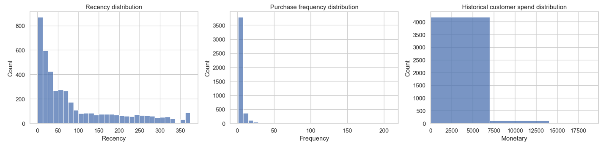
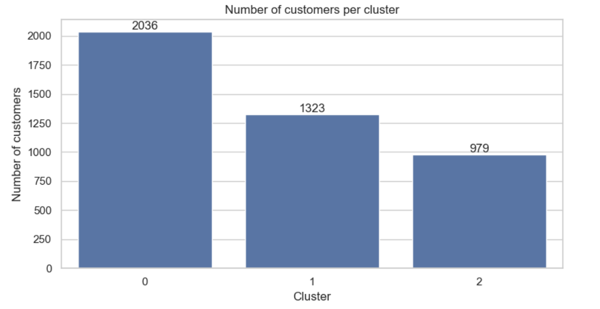

# Customer Segmentation Analysis using RFM and K-Means

**Soumya Satyajit | Data Analytics Intern, Oasis Infobyte | #oasisinfobyte**

## 📌 Project Overview

This project segments an e-commerce customer base according to purchasing behaviour using **RFM analysis** and **K-Means clustering**. The goal is to understand customer value and activity, identify groups that may need different engagement strategies, and translate the results into practical marketing recommendations.

- **Dataset:** `OnlineRetail.csv` (Online Retail transactions)
- **Notebook:** `Customer_Segmentation_RFM_KMeans.ipynb`
- **Environment:** Python and Jupyter Notebook

## 🎯 Objectives

- Inspect and prepare online retail transaction data.
- Calculate customer-level Recency, Frequency, and Monetary metrics.
- Use feature transformation and standardisation to prepare RFM features for clustering.
- Compare candidate cluster counts using the Elbow Method and silhouette score.
- Visualise and profile customer clusters.
- Recommend marketing actions based on the observed customer profiles.
- Export customer-level segments and cluster summaries.

## 📁 Project Workflow

1. **Load and inspect:** Review dataset shape, columns, missing values, and descriptive statistics.
2. **Clean transactions:** Parse dates and numeric fields; exclude records without customer ID or invoice date, cancellation invoices, and non-positive quantities or prices.
3. **Build RFM features:**
   - **Recency:** Days since the customer's most recent purchase, measured relative to the day after the latest transaction date.
   - **Frequency:** Number of distinct invoices/orders.
   - **Monetary:** Sum of positive transaction sales (`Quantity × UnitPrice`) in the available dataset.
4. **Prepare features:** Apply `log1p` to Frequency and Monetary and standardise the selected RFM features with `StandardScaler`.
5. **Evaluate clusters:** Compare K values from 2 to 8 using inertia (Elbow Method) and sampled silhouette scores.
6. **Fit K-Means:** Use a reproducible random seed; the notebook's starter choice is `K = 3`.
7. **Profile and interpret:** Review cluster metrics, visualise the groups, and assign readable segment names based on their profiles.
8. **Recommend actions:** Suggest retention, engagement, or win-back approaches for the resulting segments.
9. **Export results:** Save the customer segment table and cluster profile summary as CSV files.

## ✨ Project Highlights

- Customer-level RFM feature engineering.
- Transaction cleaning with explicit, reproducible rules.
- Log transformation and standardisation for distance-based clustering.
- Elbow and silhouette methods to help assess cluster count.
- Scatter plots and cluster-size visualisations.
- Cluster profiles using customer count, recency, order frequency, historical spend, and average purchase value.
- Rule-based segment labels:
  - **High-value loyalists**
  - **Regular / developing customers**
  - **At-risk / dormant customers**
- Segment-specific marketing recommendations.
- Exportable CSV outputs for further analysis or reporting.

## 🖼️ Preview

When the notebook is run, it displays:

- RFM feature distributions.
- Elbow Method and silhouette score charts.
- Customer cluster scatter plots (Recency vs Monetary and Frequency vs Monetary).
- Customer counts by cluster.
- Cluster profile and segment summary tables.

Add screenshots of your own notebook outputs to an `images/` folder if you want to show previews on GitHub. Example Markdown:

```markdown



```

## 🧰 Skills Demonstrated

- Python for data analytics
- Pandas and NumPy
- Data inspection, cleaning, and preprocessing
- Feature engineering and RFM analysis
- Log transformation and feature standardisation
- Scikit-learn
- K-Means clustering
- Elbow Method and silhouette score
- Data visualisation with Matplotlib and Seaborn
- Customer profiling and segmentation
- Business interpretation and marketing recommendations
- Exporting analytical results to CSV
- Jupyter Notebook documentation

## 🗂️ Repository Structure

```text
Customer-Segmentation-RFM/
├── README.md
├── Customer_Segmentation_RFM_KMeans.ipynb
├── Outputs
├── customer_segments_rfm.csv       # generated by the notebook
└── cluster_profile_summary.csv     # generated by the notebook
```
## ▶️ How to Run
Download the dataset from Kaggle and upload the zip to Google Drive.
Open sentiment_analysis_drug_reviews.ipynb in Google Colab.
Update ZIP_PATH in the first code cell to match your Drive path.
Run Runtime > Run all.


`OnlineRetail.csv` is a required input file and is not included automatically with the notebook. The two output CSV files are generated when the final notebook cell runs. Include datasets in a public repository only when you have permission to share them.

### 1. Install Python dependencies

```bash
pip install pandas numpy scikit-learn matplotlib seaborn jupyter
```

### 2. Place the dataset

Put `OnlineRetail.csv` in the same directory as the notebook. If it is stored elsewhere, update `DATA_PATH` in the notebook.

The notebook reads the CSV using `encoding="latin1"` and expects the fields used in the analysis, including `InvoiceNo`, `InvoiceDate`, `CustomerID`, `Quantity`, and `UnitPrice`.

### 3. Launch Jupyter Notebook

```bash
jupyter notebook
```

Open `Customer_Segmentation_RFM_KMeans.ipynb` and run all cells from top to bottom.

### 4. Review the outputs

Inspect the cluster evaluation charts, customer visualisations, profile tables, and marketing recommendations. The notebook saves:

- `customer_segments_rfm.csv`
- `cluster_profile_summary.csv`

## 📊 RFM Definitions and Important Notes

- **Recency:** Lower values indicate a more recent purchase.
- **Frequency:** Higher values indicate more distinct invoices/orders.
- **Monetary:** Represents historical positive sales in the available dataset; it is not predicted future customer lifetime value.
- Missing customer IDs cannot be assigned reliably to customer-level segments and are excluded from RFM analysis.
- Cancellation invoices and rows with non-positive quantities or unit prices are excluded from purchase-value calculations.
- Cluster numbers are arbitrary. Interpret clusters using their profile metrics and the segment labels, not the numeric IDs alone.
- The notebook starts with `K = 3`; review the Elbow Method and silhouette results and adjust `FINAL_K` if appropriate.
- RFM does not include product preferences, acquisition cost, campaign response, or profit margin. Validate the segments over time and test campaigns before scaling them.

## 👤 About Me

### Soumya Satyajit | Data Analytics Intern, Oasis Infobyte

I am developing my data analytics skills through practical projects involving Python, data cleaning, exploratory analysis, visualisation, and customer segmentation. This project demonstrates how transaction data can be transformed into customer-level metrics and used to explore data-driven marketing strategies.

**Internship:** Oasis Infobyte — OIBSIP Data Analytics Internship

**Hashtags:** `#oasisinfobyte` `#OIBSIP` `#DataAnalytics` `#Python` `#CustomerSegmentation` `#KMeans` `#RFM`

## 🙌 Acknowledgment

Thanks to **Oasis Infobyte** for the opportunity to practise data analytics through project-based learning.

---

*Created by Soumya Satyajit as part of the OIBSIP Data Analytics Internship.*
